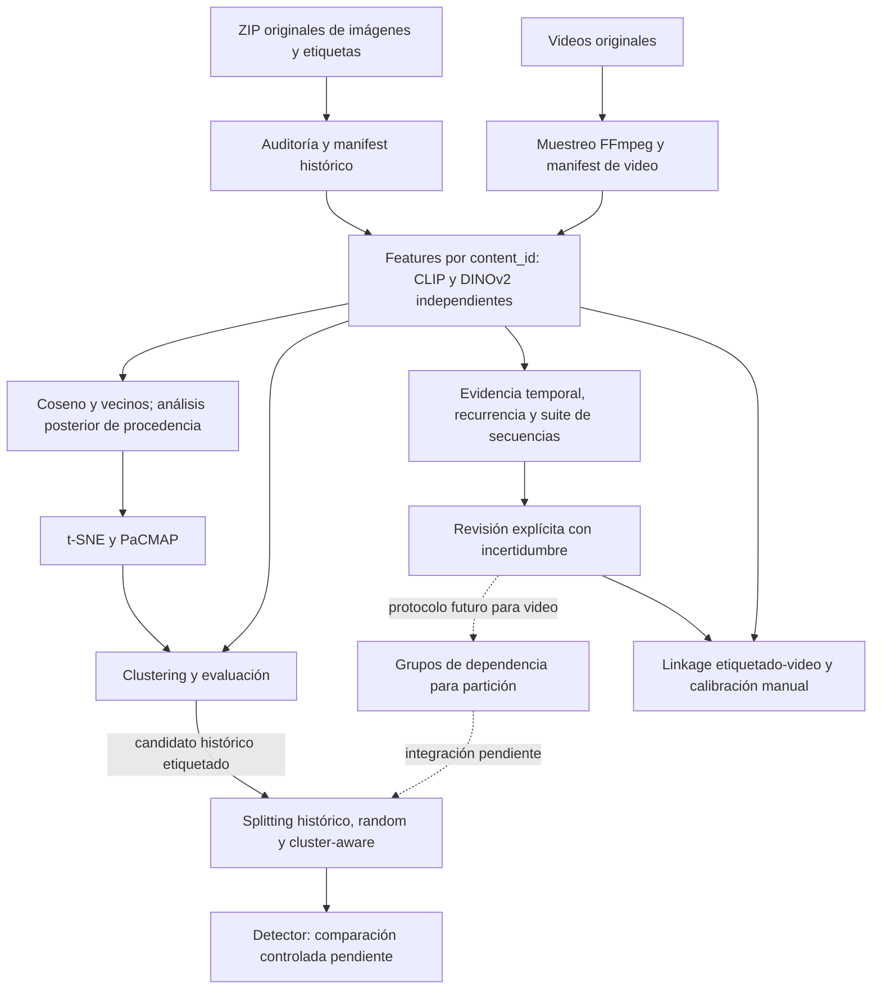

# Auditoría del repositorio y arquitectura experimental propuesta

Fecha: **2026-09-30**. Checkout auditado: `main`, commit
`34bd631cbff0a825b6b6ccbd7498c825a86a40ae`. Git estaba limpio al comenzar.
Este documento es el único cambio solicitado: **no implementa la migración**.

La auditoría combina lectura del árbol completo versionado, estructura/AST e
imports de Python, configuraciones, CLI registrado, tests, notebooks,
documentación y metadatos/tablas locales. Las cifras de archivos corresponden al
checkout anterior a este informe. No se ejecutaron modelos, nuevos experimentos,
builders con escritura, importaciones de evidencia ni jobs de Hypatia. Tampoco
se modificaron receipts, hashes, originales o resultados anteriores.

Convenciones de evidencia utilizadas:

- **Observado localmente:** archivo, configuración, código o conteo leído aquí.
- **Validación previa registrada:** resultado de un receipt existente; leerlo no
  equivale a repetir su verificación numérica o científica.
- **Reportado por el responsable:** evidencia remota descrita en documentación,
  sin acceso ni revalidación de los archivos originales en esta auditoría.
- **Infraestructura disponible:** código y pruebas sintéticas; no prueba ejecución
  completa sobre FLIR ni validez semántica de sus conclusiones.
- **Propuesto / pendiente:** trabajo que este informe no ejecuta.

Las fuentes operativas actuales son [status](../status.md),
[pipeline_traceability](../pipeline_traceability.md),
[design_decisions](../design_decisions.md) y [architecture](../architecture.md).
`docs/current_status.md` y `docs/methodology_traceability.md`, mencionados en el
contexto permanente, **no existen en este checkout**. No se recrean duplicados.
La propuesta de grado no está adjunta como archivo del repositorio: se conserva
el compromiso metodológico comunicado por el usuario sin afirmar haber cotejado
su documento original.

## 1. Objetivo actual del repositorio

El problema científico es determinar cómo representar y agrupar contenidos FLIR
altamente relacionados para evitar que copias exactas o escenas correlacionadas
atraviesen train/validation/test y produzcan una evaluación demasiado optimista
del detector. El objetivo no se satisface obteniendo clústeres visualmente
atractivos: requiere medir estabilidad, coherencia, cobertura y correlación
residual, conservar la procedencia y comparar posteriormente particiones bajo
un protocolo de detector controlado.

La unidad del ajuste visual es `content_id` único; `frame_id` conserva cada
ocurrencia histórica. DINOv2 CLS y CLIP projected-image constituyen espacios
independientes. Sus embeddings raw/L2 no incorporan etiquetas, split histórico,
diagnostics manuales ni posiciones temporales. La ruta comprometida continúa por
coseno, t-SNE/PaCMAP, DBSCAN/OPTICS/HDBSCAN, evaluación del agrupamiento y
asignación indivisible de grupos. El control de clustering en L2 original ayuda a
evaluar el efecto de la reducción; no reemplaza ese protocolo.

Actualmente coexisten dos poblaciones y varios niveles de madurez. El candidato
histórico etiquetado tiene experimentos completos almacenados hasta splitting;
la comparación completa del detector permanece pendiente. Los videos muestreados
tienen extracción y features completos reportados en Hypatia, además de evidencia
temporal legacy comunicada por el responsable. La nueva suite de secuencias,
su importación nativa y su operación distribuida están implementadas, pero la
documentación aún declara pendiente su ejecución real verificada.

La siguiente pregunta inmediata es qué relaciones temporales y visuales se
sostienen al contrastar ambos encoders, semillas, parámetros y revisión explícita,
sin convertir clústeres, cores candidatos o zonas inciertas en verdad de secuencia.
El alcance individual sigue siendo representación, agrupamiento y partición;
limpieza de ruido y segmentación panóptica pertenecen a la integración grupal.
Bhattacharyya exige una representación distribucional aún no definida; UMAP no
forma parte de la metodología principal. Agglomerative existe solo como
comparación experimental explícita de la suite de secuencias.

## 2. Pipeline canónica y arquitectura existente

### 2.1 Dependencias y estados



Las flechas punteadas son **propuestas pendientes**, no consumidores existentes.
La rama histórica de splitting no consume automáticamente los nuevos artefactos
de secuencias/linkage. El código rechaza splitting de video bajo el protocolo
histórico. Los builders y exploradores son consumidores de evidencia; no son
prerrequisitos científicos para ajustar el detector.

En la tabla, los comandos llevan el prefijo `uv run flir-pipeline`; se muestran
entrypoints, no órdenes para ejecutar ahora. `verify` puede recomputar métricas
según la etapa y debe distinguirse de `summary`/inspección.

| Etapa | Entrada | Salida | Módulo responsable | CLI | Estado y dependencia |
|---|---|---|---|---|---|
| Inventario y procedencia histórica | ZIP read-only y configuración externa | Inventario, relaciones entre archivos, duplicados/QA | `data/inventory.py`, `utils/hashing.py` | `data inventory`, `archive-tree`, `compare-archives` | Implementada; auditorías previas registradas. Punto inicial histórico |
| Manifest histórico y anotaciones | Imágenes/labels ZIP auditados | Manifest de ocurrencias, identidad de dataset, QA de etiquetas | `data/manifest.py`, `identity.py`, `yolo_labels.py`, `annotations.py`, `classes.py` | `data build-manifest`, `validate-labels`, `manifest-summary` | Manifest local: 1657 ocurrencias / 1459 contenidos; no se reparan conflictos |
| Muestreo y manifest de video | Videos + FPS/calidad; después receipt del muestreo y JPEGs | Grilla de muestras, `frames.parquet`, manifest de video | `data/video_frames.py`, `video_manifest.py`, `video_temporal.py` | `data extract-video-frames`, `build-video-manifest` | Muestreo real y puente reportados en Hypatia; no revalidados aquí. Rama independiente |
| Variante opcional | Manifest y definición/parent explícitos | Declaración de variante ligada al manifest | `data/variants.py` | `sequences experiment register-variant` | Infraestructura sintética; ubicación CLI de conveniencia. No transforma imágenes |
| QA descriptivo | Manifest e imágenes | Diagnostics y caracterización por contenido/ocurrencia | `features/diagnostics.py`, `visualization.py` | `features diagnostics`, `visualize-data`, `visualize-embeddings` | Histórico disponible. Rama de EDA; no se concatena a embeddings |
| Representación | Contenidos únicos + encoder/revisión/processor | Raw/L2, `content_index`, `record_index`, metadata/checkpoint | `features/base.py`, `dinov2.py`, `clip.py`, `storage.py`, `image_source.py` | `features extract`, `verify`, `summary` | Histórico completo local y smokes separados; video completo reportado, no local |
| Similitud | L2 verificado y manifest | Matriz coseno, vecinos, procedencia y estadísticas | `similarity/cosine.py`, `storage.py`, `video_storage.py`, `temporal*.py` | `similarity compute`, `compare`, `verify`, `summary` | Histórico completo local; v2 video implementado con pruebas sintéticas |
| Reducción y selección | Features + similitud verificadas + grid | Coordenadas, preservación, estabilidad, referencias | `reduction/reducers.py`, `storage.py`, `benchmark.py`, `metrics.py` | `reduction run`, `benchmark`, `verify`, `summary` | 36 runs históricos locales. Depende de representación/similitud, no de etiquetas |
| Clustering, evaluación y selección | L2 original y reducciones seleccionadas | Labels por contenido, ruido, métricas originales, ARI/AMI, shortlist/Pareto | `clustering/algorithms.py`, `storage.py`, `experiments.py`, `metrics.py`, `selection.py` | `clustering run`, `sweep`, `compare`, `verify`, `summary`, `inspect`, `video-review` | 414 runs históricos locales. Compatibilidad video sintética; no prueba escenas |
| Secuencias revisadas v1 | Manifest de video + ambos espacios originales + revisión confirmada | Candidatos; después instancias y componentes por copias exactas | `sequences/detection.py`, `construction.py`, `validation.py`, `storage.py` | `sequences detect`, `build`, `verify`, `summary` | Implementada; construcción real reportada por responsable, no revalidada localmente. No usa clústeres como cortes |
| Suite experimental temporal/visual | Fuentes completas, perfil y evidencia revisada cuando corresponde | Zonas, cores candidatos, clustering, recurrencia, máscaras, estabilidad y paquetes de revisión | `sequences/experiments/` | `sequences experiment boundary`, `clustering`, `recurrence`, `evaluate`, `cluster-transitions`, `suite` | Infraestructura sintética; ejecución real de esta suite pendiente. Ajuste visual independiente de evidencia manual |
| Ingesta/revisión de evidencia | Artefactos externos declarados y decisiones explícitas | Snapshots ligados a fuentes, normalización e historial inmutable | `native_schema.py`, `native_evidence.py`, `real_evidence.py`, `structure.py`, `review.py` | `sequences experiment inspect-real-evidence`, `import-real-evidence`, `import-evidence`, `review-package`, `review-import`, `verify`, `summary` | Adaptador de contratos legacy implementado; importación real pendiente, sin ground truth inventado |
| Linkage y calibración | Dos manifests, cuatro stores y secuencias/grupos suministrados | Unión top-k, scores por encoder, todas las ocurrencias, decisiones y agregados | `linkage/candidates.py`, `sources.py`, `storage.py`, `review_*.py` | `linkage build`, `verify`, `summary`; `linkage review init/record/summary/verify/aggregate/aggregate-verify` | Candidatos y revisión disponibles; compatibilidad real init/verify reportada. Agregación real pendiente |
| Comparación de variantes | Suites completas congeladas; correspondencia opcional | Métricas descriptivas y cobertura de pairing | `sequences/experiments/variant_comparison.py` | `sequences experiment import-correspondence`, `compare-variants` | Sintética; no-HUD real no evaluado. No reajusta modelos ni crea grupos |
| Partición y evaluación residual | Manifest histórico, clústeres y similitud de ambos encoders | Asignaciones indivisibles, baselines, métricas, Pareto | `splitting/construction.py`, `storage.py`, `experiments.py`, `metrics.py`, `selection.py` | `splitting build`, `baseline`, `evaluate`, `compare`, `verify`, `summary`, `export-lists` | 66 runs históricos locales; no es aún un protocolo de splitting de video |
| Detector controlado | Selección congelada, vistas de datos y runtime/pesos explícitos | Plan/matriz, pilotos, entrenamiento y métricas/bootstrap | `detection/protocol.py`, `materialization.py`, `runtime.py`, `metrics.py`, `reporting.py`, `association.py` | `detection plan`, `materialize`, `environment`, `smoke`, `probe`, `pilot-small`, `freeze`, `run`, `verify` | Cuatro pilotos CPU locales; 0/48 runs controlados según evidencia guardada. Comparación final pendiente |
| Inspección y reporting | Artefactos existentes y fuentes verificables | HTML, notebooks ejecutados, tablas, VIKUS/Streamlit | `explorer/`, `apps/`, `scripts/build_*_review.py`, visualización de cada dominio | `explorer vikus-build`, `vikus-serve`; scripts/Streamlit | Disponible; reportes privados locales. Éxito de render no certifica coherencia científica |

### 2.2 Entry points e inventario arquitectónico

`pyproject.toml` define **un console script**:
`flir-pipeline = flir_pipeline.cli:app`. La inspección del árbol Typer confirma
10 namespaces: `data`, `features`, `similarity`, `reduction`, `clustering`,
`splitting`, `detection`, `explorer`, `sequences`, `linkage`. Los dos últimos
incluyen `experiment` y `review`, respectivamente. La tabla anterior enumera
todos sus comandos actuales, incluidos los registros dinámicos de
`sequences/experiments/cli.py`.

También existe el entrypoint operacional
`python -m flir_pipeline.sequences.experiments.slurm` con `submit`, `worker`,
`status`, `resubmission-plan`. No hay un CLI genérico `experiments` actualmente.
Los dos `apps/*.py` se lanzan mediante Streamlit. `Makefile` y pre-commit son
atajos de desarrollo; CI ejecuta Ruff, pytest y limpieza de notebooks.

El árbol inicial tiene **269 archivos trackeados**: 126 bajo
`src/flir_pipeline`, 38 bajo `tests`, 41 documentos en `docs`, 28 archivos en
`configs` (22 YAML, README y cinco `.gitkeep`), 12 scripts, siete notebooks y
dos apps, además de los archivos raíz/de herramientas. El paquete ocupa 25278
líneas físicas, incluyendo sus assets; el conteo no es una medida de calidad.

| Área | Responsabilidad real y módulos que la completan |
|---|---|
| `data/` | Inventario, manifest, identidad, labels, clases/anotaciones, inferencia temporal, imágenes locales, video y variantes; no hay un servicio remoto de datos |
| `features/` | Contrato/extractor fake para tests, CLIP/DINOv2, preprocessing, revisión de modelos, transporte de imagen, storage/resume, diagnostics y visualización |
| `similarity/` | Coseno/top-k, almacenamiento histórico/v2, dos semánticas temporales, comparación entre encoders y presentación |
| `reduction/` | Config, adaptadores, preservación, benchmark/selección, storage y visualización |
| `clustering/` | Config, adaptadores, distancias con retención acotada, evaluación, selección, sweep/comparison, inspección de receipts y dos rutas de reporte histórico/video |
| `sequences/` | Detección original-L2, construcción revisada, validación/storage; `experiments/` contiene 20 módulos Python, incluido su `__init__`, para la rama experimental |
| `linkage/` | Candidatos inter-dataset y almacenamiento; revisión manual, fuentes, medios, modelos, agregación y verificación separadas |
| `splitting/` | Construcción atómica/MILP, métricas posteriores, selección, experimentos, storage, CLI y figuras |
| `detection/` | Plan/materialización, runtime opcional, métricas/reporting y asociaciones con contexto residual |
| `explorer/` | Discovery y joins de solo lectura, timelines/previews, VIKUS/export/servidor/runtime y assets JS/CSS |
| `utils/` | Hashing por streaming. Parte de la utilidad transversal de JSON/procedencia vive todavía en `similarity/storage.py` |
| `cli.py`, `config.py` | CLI principal de 681 líneas; `PipelineConfig` de 15 líneas documentado como contrato futuro, no configuración activa general |

No existen paquetes generales `evaluation/` o `experiments/` en la raíz de
`src/flir_pipeline`: las métricas y orquestaciones están junto a cada dominio.
Esto es una arquitectura real más avanzada que el esquema conceptual inicial,
no una carpeta faltante que deba rellenarse automáticamente.

## 3. Inventario y clasificación de scripts

Aquí **producción** significaría herramienta permanente del pipeline académico,
no deployment productivo. Se asigna una categoría principal; una herramienta
de reporting puede ser permanente sin reclasificarla como servicio productivo.

### 3.1 Los doce archivos de `scripts/`

| Script | Líneas | Clasificación | Justificación y disposición |
|---|---:|---|---|
| `build_feature_engineering_review.py` | 110 | report builder | Verifica cobertura full, genera QA/figuras y ejecuta el notebook; soporta selección explícita y discovery no ambiguo. ACTIVE |
| `build_similarity_review.py` | 67 | report builder | Consume dos espacios y su comparación, genera galerías ZIP y receipt de outputs; rechaza video v2. ACTIVE |
| `build_reduction_review.py` | 57 | report builder | Consume benchmarks y similitud explícitos; figuras, notebook/HTML y hashes de outputs. ACTIVE |
| `build_clustering_review.py` | 61 | report builder | Consume comparación, especificación de entradas e imágenes para revisión histórica verificada. ACTIVE |
| `build_splitting_review.py` | 53 | report builder | Lee comparación, produce nueve figuras/tablas y exporta notebook/HTML. ACTIVE |
| `build_detector_review.py` | 53 | report builder | Render condicionado por evidencia; conserva paneles pendientes cuando falta matriz controlada. ACTIVE |
| `build_progress_review.py` | 616 | report builder | Consolidación narrativa de 22 secciones; disponibilidad, receipts, consistencia y privacidad. Su `--check` no escribe. ACTIVE; candidato a separar responsabilidades |
| `check_notebook_source.py` | 47 | validation | Inspecciona los siete notebooks sin ejecutarlos; rechaza outputs, attachments, paths/hashes sensibles y compila celdas. Invocado en CI. ACTIVE |
| `hypatia/sequence_suite.sbatch` | 21 | orchestration/HPC | Launcher serial dentro de una asignación; activa entorno y llama `sequences experiment suite`. Mantener como vía simple de control/piloto |
| `hypatia/sequence_suite_submit.sh` | 7 | orchestration/HPC | Wrapper del planificador Python; configura offline e hilos y se sitúa en raíz. No contiene fitting. ACTIVE |
| `hypatia/sequence_suite_status.sh` | 4 | orchestration/HPC | Wrapper de accounting + verificación de receipts. ACTIVE |
| `hypatia/sequence_suite_resubmission_plan.sh` | 5 | orchestration/HPC | Genera plan de recuperación sin cancelar/enviar jobs implícitamente. ACTIVE |

No se identificó un script versionado inequívocamente **legacy**, **debugging**
o **candidato a eliminación**. La coexistencia del launcher serial y el DAG no
los vuelve redundantes científicamente: permiten control serial frente a ejecución
por etapas y tienen tests de equivalencia. Los `.pyc` locales son GENERATED e
ignorados, no scripts fuente.

### 3.2 Utilidades locales fuera de Git

Se encontraron once `.py` bajo `reports/`. Se inspeccionaron sus estructuras,
imports y operaciones, **sin ejecutarlos**. No forman parte de `scripts/` ni
puede un clone público depender de su presencia.

| Ubicación relativa a `reports/` | Clasificación | Disposición propuesta, no ejecutada |
|---|---|---|
| `code_review/audit_local.py` | validation | Auditoría agregada y diagnóstico de parciales; conservar junto a evidencia de la revisión |
| `code_review/build_review_report.py` | report builder | Informe puntual anterior; candidato a archivo documental local si sus receipts quedan preservados |
| `code_review/final_audit.py` | validation | Cierre de revisión anterior, con controles de privacidad; no eliminar por antigüedad |
| `code_review/prepare_cleanup.py` | validation | Inspecciona checkpoints/equivalencia y emite evidencia; el nombre no implica autorización para borrar |
| `code_review/reconcile_annotations.py` | validation | Reconciliación de objetos/labels históricos; conservar evidencia; evaluar si hace falta API repetible |
| `code_review/update_sources.py` | legacy / debugging | Mutador puntual de fuentes mediante reemplazos y escrituras. Candidato a archivado local; no reutilizar como pipeline |
| `explorer/check_vikus_local.py` | validation | Verificación real local de bundle/coordenadas; mantener como procedencia del receipt |
| `explorer/smoke_local.py` | validation | Smoke local Streamlit/preview, distinto de tests sintéticos offline |
| `feature_engineering_closure/final_audit.py` | validation | Cierre real con dependencias/artefactos locales; no es un test de CI |
| `feature_engineering_closure/run_full.py` | orchestration/HPC | Orquestador local de dos extracciones y receipts; no es un job SLURM. Candidato a incorporar mediante adaptador, preservando el original |
| `progress/generate_source.py` | legacy | Generador puntual del notebook fuente ya versionado; candidato a archivado tras confirmar que no tiene consumidores |

La categoría legacy en las dos utilidades de autoría significa uso puntual
observado, no obsolescencia demostrada. Ninguna se borra. Un futuro archivo local
debe mantener locators o copias referenciadas por receipts; mover originales
puede invalidar verificaciones que requieren su ubicación.

## 4. Inventario experimental y configuraciones

### 4.1 Familias, preguntas y evidencia

| Familia | Pregunta y configuración/código inspeccionados | Evidencia y trabajo pendiente |
|---|---|---|
| Auditoría/canonicalización | ¿Cuántas ocurrencias, contenidos, copias y conflictos hay? `data/*` y opciones CLI | Manifest local leído: 1657/1459, 198 grupos duplicados y cross-split; receipt: 57 train-val, 141 train-test, 0 val-test, 396 ocurrencias implicadas. QA no reejecutado sobre ZIP |
| Representaciones smoke/full | ¿La extracción/indexación es correcta y cubre contenidos únicos? `embeddings/*_smoke.yaml`, `*_full.yaml`, `features/storage.py` | Arrays full locales CLIP 1459×512 y DINOv2 1459×384; raw/L2 float32. Smokes N=16 en stores separados, incluidos smokes de revisión; existe un fake 16×8 para infraestructura, no encoder científico |
| Encoders mayores | ¿Conviene evaluar otro tamaño de modelo? `embeddings/*_research.yaml` | DINOv2-base y CLIP ViT-L/14 son candidatos no ejecutados; revisión nula y resolución obligatoria. No confundir con los modelos full ni priorizarlos antes de cerrar evidencia base |
| Coseno histórico | ¿Qué vecinos/relaciones visuales hay y cuánto atraviesan el split histórico? `similarity/*_research.yaml`, `cosine.py`, `temporal.py`, `comparison.py` | Dos análisis completos y comparación locales; receipts previos. Temporalidad inferida por nombres; proximidad no equivale a leakage confirmado |
| Preservación dimensional | ¿Qué reduce preservando vecindarios y estabilidad? Dos YAML de `reduction/`, `benchmark.py` | 2 encoders × 2 métodos × 3 parámetros × 3 semillas = 36 runs locales; dos benchmarks. Cuatro referencias documentadas, no escenas verdaderas |
| Clustering histórico | ¿Qué grupos/noise y estabilidad producen espacios/algoritmos? Tres grids de `clustering/`, `experiments.py`, `selection.py` | 342 screening + 72 seeds adicionales = 414 runs locales: 132 DBSCAN, 186 OPTICS, 96 HDBSCAN; 54 shortlist, 41 Pareto y 204 comparaciones guardadas |
| Splitting histórico | ¿Qué correlación residual queda respetando grupos y balance? Dos YAML de `splits/`, `construction.py`, `experiments.py` | 1 histórico + 5 random-content + 12 candidatos × 5 seeds = 66 runs; receipts registran 65 nuevos sin overlap exacto y cero fracturas cluster-aware. No implica independencia visual total |
| Detector y asociaciones | ¿Cómo cambia P/R/mAP frente a histórico/random y candidatos congelados? `detection/yolo11n.yaml`, `associations.yaml`, `protocol.py`, `runtime.py` | 16 contextos y matriz objetivo de 48, cuatro pilotos CPU locales; 0 runs controlados según receipt. Siete asociaciones descriptivas predeclaradas. No hay resultado comparativo final |
| Muestreo/puente de video | ¿Puede reconstruirse una grilla y extraer sin duplicar densidad? `video_frames.py`, `video_manifest.py`, `features/image_source.py` | Hypatia reportado: 9648 muestras / 8093 contenidos; no hay manifest/store de esa población en las raíces locales inspeccionadas |
| Coseno v2 y downstream video | ¿Qué relaciones visuales y de grilla aparecen preservando todas las ocurrencias? YAML `*_video_research`, `video_storage.py` | Infraestructura sintética. `summary_only_v1` omite pares completos, no matriz/top-k ni resúmenes exactos; no intercambiar con semántica histórica |
| Secuencias revisadas v1 | ¿Dónde proponer cambios L2 y cómo construir intervalos tras revisión? `sequences/research.yaml`, `detection.py`, `construction.py` | Código/tests locales; publicación real reportada por responsable, no revalidada. Confirmación manual requerida; componentes exactos separados de evidencia visual |
| Ingesta nativa legacy | ¿Puede conservarse e interpretar evidencia remota existente sin promover sus inferencias? `native_schema.py`, `native_evidence.py`, `real_evidence.py` | Cuatro contratos observados, 14 archivos ligados; aceptación para revisiones conocidas con 910 ocurrencias/712 índices, 13 cores/12 zonas y 78 pares/11 candidatos. Son checks de un adaptador, no resultados recién obtenidos |
| Suite temporal/visual | ¿Qué cambios/recurrencias y estructuras sobreviven a encoders, seeds y parámetros? Perfil Hypatia y `boundary/fitting/evaluation/recurrence/transitions/runner/stages.py` | Perfil expandido aquí sin fitting: 154 fits y 82 etapas/jobs. No se encontraron publicaciones ni `slurm_run.json` de esta suite en las raíces locales; documentación declara ejecución real pendiente |
| Revisión y linkage | ¿Qué relaciones etiquetado-video tienen soporte visual y qué ambigüedad persiste? `linkage/*`, review y agregación | Compatibilidad real init/verify reportada; agregado local real no presente. Tasas del conjunto revisado no son accuracy representativa |
| Variantes/no-HUD | ¿Cambian las evidencias bajo preparación explícita y población comparable? `data/variants.py`, `variant_comparison.py` | Solo infraestructura sintética. Comparación real no-HUD pendiente; necesita manifests propios y correspondencias explícitas, sin equivalencia de bytes inventada |
| Memoria y compatibilidad | ¿Se preservan outputs al acotar retención de distancias? `clustering/distances.py`, fixture y tests de memoria | Experimento de ingeniería con oracle sintético; no constituye clustering real N=8093 ni medición de MaxRSS en Hypatia |

**No se declara obsoleta ninguna familia ejecutada.** El baseline histórico,
los smokes y las ejecuciones con metadata anterior conservan valor de control
y procedencia. Los protocolos nuevos no reemplazan retrospectivamente IDs o
resultados. C10/C01 (anclas de splitting) y C10/C12 (selección del detector) tienen
funciones distintas, no una contradicción que deba corregirse sobrescribiéndolos.

### 4.2 Inventario de los 22 YAML

| Archivos bajo `configs/` | Contenido efectivo / consumidor | Interpretación |
|---|---|---|
| `embeddings/clip_smoke.yaml`, `dinov2_smoke.yaml` | Modelos base/small, CPU/batch 8, raw/L2; revisión no fijada obligatoriamente | El YAML no limita N: hace falta `--limit-content 16 --seed 0` |
| `embeddings/clip_full.yaml`, `dinov2_full.yaml` | Mismos modelos full, SHA de revisión fijado, pooling explícito y revisión resuelta obligatoria | Configuraciones ejecutadas, no sustituir por research |
| `embeddings/clip_research.yaml`, `dinov2_research.yaml` | CLIP-large/DINOv2-base, revisión pendiente, device auto | FUTURE; mantener y etiquetar como candidatos |
| `similarity/clip_research.yaml`, `dinov2_research.yaml` | Coseno float32, top-20, seis cuantiles y bins de índice | YAML equivalentes al parsearlos; separación nominal por encoder, entradas por CLI |
| `similarity/clip_video_research.yaml`, `dinov2_video_research.yaml` | V2, grilla explícita, `summary_only_v1`, bins de muestras y segundos independientes | También equivalentes al parsearlos; contrato distinto de histórico |
| `reduction/tsne_research.yaml` | Perplexity 10/30/50, seeds 0/1/2, 2D, init PCA, sin pre-PCA | 9 runs por encoder |
| `reduction/pacmap_research.yaml` | MN_ratio 0.2/0.5/1.0, seeds 0/1/2, 2D, `apply_pca=false`, init PCA | 9 runs por encoder; initializer no es reducción previa |
| `clustering/dbscan_research.yaml` | min_samples 5/10/20 × seis cuantiles epsilon | 18 configuraciones por espacio, epsilon derivado en cada espacio |
| `clustering/optics_research.yaml` | min_samples 5/10/20 × xi .03/.05/.10 × min_cluster_size 10/20/30 | 27 configuraciones |
| `clustering/hdbscan_research.yaml` | min_cluster_size 10/20/30/50 × min_samples 5/10/20, EOM | 12 configuraciones; scikit-learn del extra reduction |
| `clustering/inputs.example.yaml` | Manifest y tres locators por encoder | Plantilla explícita con placeholders; no experimento ejecutable sin resolver entradas |
| `splits/random_baseline.yaml` | random_content, seeds 0–4, ratios derivados del manifest | Control reproducible a nivel de contenido |
| `splits/cluster_aware_research.yaml` | Noise singleton, seeds 0–4, SciPy MILP, límites/pesos | Balance usa labels después del clustering; contraste con random no aísla solo efecto del agrupamiento |
| `sequences/research.yaml` | 1 FPS, ventanas 3/5/10/20, percentiles y radio de localización v1 | Control revisado v1, no grid de la suite nueva |
| `hypatia_sequence_experiments.yaml` | Encoders, representación, algoritmos, fronteras/recurrencia/transiciones + bloques operativos `inputs/slurm` | Es ya una especificación experimental parcial; Pydantic separa configuración científica de recursos/rutas |
| `detection/yolo11n.yaml` | YOLO11n, versiones, train/eval, seeds 42/43/44 y split seeds 0–4 | Plan controlado; batch se decide mediante probe y freeze |
| `detection/associations.yaml` | Siete vistas métricas/residual, categoría y población | Registro descriptivo independiente del plan de entrenamiento |

Los cinco `.gitkeep` no son configs vacías a completar arbitrariamente.
No hay YAML UMAP ni una representación Bhattacharyya implementada.

### 4.3 Evidencia local y alcance de esta inspección

Se enumeraron **7588 archivos en `artifacts/` (~438.6 MiB)**,
**4987 en `reports/` (~1164.4 MiB)** y **3 en `data/`**. Son snapshots locales
ignorados; los conteos incluyen imágenes de vistas del detector, bundles y
reportes, no equivalen al número de ejecuciones científicas. Se distinguieron
`artifact_kind`, shapes y tablas en lugar de inferir estados por nombres de carpetas.

Los flags guardados `quality_valid=true` aparecen en 36 reducciones,
414 clusterings y 66 splits. Se leyeron receipts de extracción, similitud,
reducción, clustering, reproducción de splits y detector. **No se volvió a
verificar numéricamente ese conjunto ni a leer sus ZIP originales.**
`build_progress_review.py --check` sí comprobó en esta auditoría disponibilidad,
consistencia agregada y checksums que su lector contrasta: **57 fuentes,
0 ausentes/inválidas y 22/22 secciones disponibles**. No es una revalidación
global de escenas, métricas o inferencias remotas.

## 5. Deuda técnica y riesgos concretos

### 5.1 Hallazgos priorizados

| Prioridad | Evidencia concreta | Consecuencia | Cambio futuro mínimo |
|---|---|---|---|
| Alta | `feature_space_id`, `clustering_space_id`, `detector_run_id`, `run_id` de celda, `seq-*`, collection IDs y receipts de reportes responden a identidades distintas | No hay consulta transversal que una pregunta, intento, fuentes, outputs y validación | Contrato de ejecución externo con IDs nativos preservados; registry derivado |
| Alta | `slurm.plan_run()` incluye rutas absolutas, cwd y recursos en su identidad operacional; la celda de fitting tiene otra identidad científica | Reubicar un plan cambia `seq-*`; confundirlo con identidad matemática dificulta comparación | Separar `experiment_id`, clave científica, intento y locator; no recalcular IDs históricos |
| Alta | Worker guarda receipt exitoso y job ID, pero no un lifecycle uniforme de inicio/fin/fallo; `sacct` solo consulta State/ExitCode | Runtime/MaxRSS y motivo de fallo no quedan normalizados para toda la pipeline | Eventos/resultado por intento, accounting y campos null explícitos cuando no existan |
| Alta | Ausencia local de fuentes/suites Hypatia y estados documentales parcialmente reportados por responsable | Un registry basado solo en documentación podría dar por ejecutado lo pendiente | Registrar origen de evidencia y nivel de verificación; importar fuentes reales antes de afirmar validación |
| Media | Seis builders repiten NotebookClient, HTMLExporter, rutas de cache, escritura y receipts; el builder feature tiene variantes de ese flujo | Mantenimiento duplicado y contratos de output distintos | Extraer solo render/receipt común tras tests; conservar opciones y rutas públicas |
| Media | `build_progress_review.py` (616 líneas) mezcla catálogo de fuentes, selección, narrativa, HTML/CSS, privacidad y publicación | Difícil ampliar a suites video y pruebas aisladas | Separar lector/adaptador, agregación y presentación; mantener su `--check` |
| Media | `_git_commit()` tiene AST idéntico en `data/manifest.py`, `features/storage.py`, `features/visualization.py`; SHA/JSON similares en `utils/hashing.py` y `similarity/storage.py` | Duplicación real, pero cambiar serialización puede cambiar identidades | Consolidación posterior con pruebas de bytes/IDs; no unificar todos los hashes ciegamente |
| Media | Muchas capas importan JSON/SHA/provenance de `similarity/storage.py`; `sequences/experiments` importa helpers privados de `linkage/sources.py` y `review_storage.py` | Utilidad compartida situada en un dominio y acoplamiento de validación/IO | APIs públicas pequeñas con wrappers compatibles, sin reescribir kernels |
| Media | `data/manifest.py` importa `_basename/_filename_features/_split_for_path`; video importa privados de manifest; CLIs secundarios y builders usan `_default_root` de CLI principal | Dependencias invertidas hacia CLI/helpers internos | Extraer resolución operacional solo cuando se adopte API común; mantener firmas anteriores |
| Media | `data/inventory.py` 922 líneas; `features/visualization.py` 830; `native_evidence.py` 836; `variant_comparison.py` 791; `detection/runtime.py` 697 | Inspección y revisión costosas; funciones de 150–223 líneas en varios dominios | Separaciones por responsabilidad, una por commit; longitud por sí sola no prueba error |
| Media | `*_research` significa modelos mayores pendientes en embeddings, pero análisis ya ejecutado en similarity/reduction/clustering | El nombre no revela estado ni pregunta | Catálogo experimental declarativo con estado derivado; no renombrar YAML consumidos |
| Media | Dos pares de YAML de similitud son iguales después de `safe_load` | Duplicación pequeña, potencial drift entre encoders | Base compartida opcional con config resuelta persistida; preservar alias y espacios independientes |
| Media | `parameters/grid` en suite frente a `hyperparameters/grid` en reductores/clustering; dataclasses y Pydantic conviven | Misma intención con interfaces distintas; defaults implícitos requieren expansión | Adaptadores que congelen configuración efectiva, sin imponer un parser universal |
| Media | Salidas mezclan `output_sha256`/`output_checksums`, metadata/report_metadata, CSV/Parquet y distintas formas de `verify` | Agregación genérica no puede asumir un único schema ni significado de éxito | Lectores por versión y normalización explícita; ausente no equivale a cero |
| Media | `features/storage.py` guarda commit pero no dirty state ni tiempos/recursos completos; stages nuevos tienen procedencia más amplia | Reproducción de runs viejos no puede reconstruir campos nunca registrados | Adopción de legacy con null + motivo; nunca atribuir el commit actual al fitting pasado |
| Media | `versions()` de suite protege código propio y una lista de helpers reutilizados; no es un fingerprint exhaustivo de todo el cierre transitivo | Es un control fuerte, pero no reemplaza un snapshot completo de fuentes/entorno | Nuevo contrato añade lockfile y árbol de código privado reproducible; conserva fingerprints nativos |
| Baja | README omite `clustering inspect/video-review` y `sequences experiment` en su tabla aunque los describe parcialmente; `configs/README.md` no cataloga el perfil Hypatia | Discovery incompleto desde la entrada principal | Regenerar/cotejar índice CLI/configs en limpieza documental posterior |
| Baja | `features/__init__.py` aún dice “Full extraction is pending” | Contradice arrays y status actuales | Corregir docstring en commit documental separado |
| Baja | README/status/architecture/traceability/runbooks repiten límites y estado de la suite | Riesgo de divergencia; el histórico fechado sigue siendo útil | Un solo catálogo de estado con enlaces; conservar decisiones/resultados fechados |
| Baja | `PipelineConfig` y placeholders tienen función futura documentada | Un escáner de imports los marcaría erróneamente como basura | Clasificar FUTURE, conservar hasta una decisión explícita |

`runner.py` y `stages.py` no deben fusionarse solo por solapamiento nominal:
comparten funciones científicas y agregación para serial/SLURM. Igualmente,
`similarity/storage.py` y `video_storage.py` tienen contratos temporales distintos;
dos rutas de review histórico/video protegen poblaciones distintas. Existe deuda
de coordinación, no evidencia de que esos contratos deban borrarse.

### 5.2 Git, archivos generados y seguridad de datos

- `git ls-files -ci --exclude-standard` no devolvió archivos trackeados que
  coincidan con las exclusiones actuales. No hay manifests, embeddings, imágenes,
  pesos, ZIP, HTML, notebooks ejecutados o `.env` en el árbol trackeado inspeccionado.
- `tests/fixtures/clustering_memory_737e588.json` es el único JSON trackeado:
  contiene un oracle **sintético intencional**, ligado a `clustering_memory_reference.py`
  y tests de regresión. Aunque se generó mediante cálculo, no es un resultado FLIR
  publicado accidentalmente y debe conservarse.
- Los siete notebooks fuente tienen outputs vacíos y execution counts nulos.
  `.gitignore` protege datos, formatos binarios, modelos, artifacts, reports,
  caches, entornos y `.env`; permite `.env.example` y `.gitkeep` pertinentes.
- Se revisaron rutas personales/token-like por patrones en los archivos
  trackeados. El único match de ruta personal inspeccionado fue un ejemplo
  sintético negativo de `tests/test_progress_review.py`; no una ruta privada real.
  Este chequeo no se presenta como auditoría exhaustiva de secretos de todo el
  historial Git. No se escanearon ni publicaron valores de `.env`.
- No se encontraron directorios/archivos `.partial` actuales bajo `artifacts/`.
  Los JSON locales sobre limpiezas anteriores son evidencia histórica, no una
  orden para eliminar nada ahora. Futuras limpiezas deben validar dataset, espacio,
  checkpoint y output final equivalente.
- Antes de escribir este informe se congeló un inventario de tamaño/mtime de
  `data/`, `artifacts/`, `reports/` y un digest agregado del contenido de sus JSON,
  para comprobar preservación al cierre sin versionar identificadores privados.

No hay un hallazgo confirmado de **resultados reales generados accidentalmente
versionados** en el checkout actual. Las utilidades locales mutadoras y logs
de servidor bajo `reports/` son deuda de organización privada, no una filtración
demostrada en Git. No se propone limpieza automática de los bundles o receipts.

### 5.3 Tests y CI

`tests/` contiene 35 módulos `test_*.py`, `conftest.py`, un helper y el oracle
sintético. Se inspeccionaron funciones/imports y fronteras de sus fixtures:
datos/identidad/labels, extracción/revisiones/QA, similitud histórica/video,
reducción, clustering/memoria, splitting, detector/associations, exploradores,
secuencias, operación, importación nativa, variantes y revisión/linkage.
No se añadieron tests para esta modificación exclusivamente documental.

`conftest.py` bloquea conexiones socket y fuerza Hugging Face/Transformers offline.
CI instala `core + dev + reduction` con `uv sync --locked`, configura un hilo
OMP/Numba y ejecuta Ruff, pytest y notebook-source. No instala vision/detection
ni descarga modelos o datos para las pruebas. La instalación de dependencias
en CI sí puede requerir red; el cálculo de los tests no debe requerirla.
Los tests de reducción incluyen reductores reales sobre fixtures pequeños.
La ejecución de esta auditoría registró 3 h 22 min 08 s (detalle en §10.2): no
describir el suite como un smoke instantáneo. No se perfiló la causa de esa
duración ni se usa como benchmark de un experimento FLIR.
La equivalencia serial/etapas, rechazo de fuentes alteradas, masks, noise,
incertidumbre y no promoción a ground truth son controles científicos relevantes.

## 6. Estructura objetivo mínima propuesta

**Conviene introducir `experiments/` para especificaciones** que unan pregunta,
población, fuentes lógicas, configs, grid, criterios de aceptación y productos.
No debe almacenar resultados, manifests reales ni localizadores privados.
`configs/` conserva parámetros reutilizables; una especificación referencia esos
archivos y registra su expansión completa al ejecutar. El perfil Hypatia actual
ya cumple parte de ese papel y debe seguir siendo aceptado.

**Conviene un `src/flir_pipeline/experiments/` pequeño como capa transversal**
solo para contrato, registry, planificación/adaptación y agregación. No trasladar
allí `boundary`, `recurrence`, `fitting`, reducción o clustering. Tampoco crear
otro motor DAG que replique `sequences/experiments/stages.py`.

```text
experiments/                         # NUEVO, especificaciones públicas
  README.md                         # preguntas, versiones y consumidores
  historical_grouping_v1.yaml        # catálogo de protocolo; no rerun implícito
  sequence_evidence_v1.yaml          # referencia al perfil existente

configs/                            # EXISTENTE; rutas públicas preservadas
scripts/
  build_*_review.py                  # EXISTENTES; wrappers compatibles
  check_notebook_source.py
  hypatia/                          # EXISTENTE; transporte fino
src/flir_pipeline/
  data/ features/ similarity/ reduction/ clustering/
  sequences/experiments/             # lógica científica y DAG actuales
  linkage/ splitting/ detection/ explorer/ utils/
  experiments/                      # NUEVO, implantación incremental
    contracts.py                    # spec + intento + referencias/evidencia
    registry.py                     # índice derivado/reconstruible
    adapters.py                     # lectores y llamadas a APIs existentes
    planner.py                      # validación/expansión; delega DAG de secuencias
    aggregation.py                  # joins por IDs y métricas normalizadas
  reporting/                        # OPCIONAL cuando se extraiga código común
    notebook.py                     # render/receipt compartido, sin fitting

artifacts/                          # IGNORADO; stores antiguos intactos
  experiment_runs/<run_id>/          # NUEVO; plan/resultado/eventos por intento
  experiment_registry/              # NUEVO; índice Parquet reconstruible
reports/                            # IGNORADO; vistas y receipts nuevos
docs/                               # EXISTENTE; protocol / analysis / runbook
```

Los dos nombres YAML y las nuevas APIs son una propuesta, **no archivos creados**.
Introducir un módulo solamente cuando el commit correspondiente tenga consumidor
y tests. Puede empezar con contrato/registry y un adaptador de suite; generalizar
el planificador al segundo caso real. Python, Pydantic existente, JSON/Parquet y
SLURM son suficientes; no se justifican Airflow, Prefect, MLflow ni una base de
datos de servicio para este alcance.

Invariantes de compatibilidad: mantener `src/flir_pipeline`, comandos actuales,
config paths, helpers públicos existentes, esquemas/serialización versionados,
hashes y receipts antiguos. Wrappers o adaptadores externos pueden añadir
trazabilidad; no insertar sidecars dentro de publicaciones cuyo verifier exige
un inventario exacto de archivos.

## 7. Contrato mínimo de experimento y ejecución

### 7.1 Identidades y almacenamiento

Separar cuatro conceptos:

1. `experiment_id`: pregunta/protocolo declarativo versionado, con `spec_sha256`.
2. `scientific_config_id`: población/selección, espacios, parámetros, seeds,
   protocolo y versiones relevantes. Independiente de paths, batch operativo y
   job ID; preservar los IDs científicos actuales como referencias nativas.
3. `run_id`: intento único con fecha de creación, por ejemplo UUID; un retry
   tiene otro intento y `retry_of`. No reinterpretar el `run_id` de celda actual
   ni el `seq-*` existente: conservarlos en `native_ids` con namespace/esquema.
4. `artifact_id` + SHA256: producto publicado y bytes concretos. Reutilizar un
   artefacto validado no es una nueva ejecución de fitting.

Propuesta por intento: `plan.json` congelado, `events/<event_id>.json` escritos
atómicamente por su dueño y `result.json` final inmutable. El resumen de estado
es una proyección; no exigir sobrescribir receipts inmutables para mostrar progreso.
Para muchos workers, usar un registro por etapa/intento y un único agregador,
evitando que varios procesos reescriban el mismo JSON o Parquet.
`runs.parquet`, `artifacts.parquet` y `metrics.parquet` son índices derivados:
pueden reconstruirse desde esos registros y publicaciones verificadas.

### 7.2 Campos obligatorios y semántica

| Grupo | Campos mínimos | Regla |
|---|---|---|
| Contrato | `schema_version`, `experiment_id`, `spec_version`, `spec_sha256`, `question`, `protocol` | Expresa la pregunta y el universo antes de ejecutar |
| Intento | `run_id`, `parent_run_id`, `stage_id`, `attempt`, `retry_of`, `created_at`, `started_at`, `finished_at` | UTC ISO-8601; tiempo desconocido = null con motivo, nunca fecha de importación como fecha de fitting |
| Código | `git.commit_sha`, `git.dirty`, `git.source_snapshot_sha256`, `git.lockfile_sha256` | Commit real del cómputo, estado dirty conocido o null; snapshot de código sin datos/secretos, almacenado privadamente |
| Entorno | `software.python`, versiones de paquetes/backend/encoder, plataforma | Lockfile no incluye los pesos; registrar revisión resuelta del modelo |
| Dataset | `dataset_id`, `dataset_variant_id`, `manifest_sha256`, `population`, `selection`, `n_occurrences`, `n_contents`, `provenance_mode` | Distinguir full, subset, smoke; frame y content no intercambiables |
| Inputs | Lista de `role`, `schema`, `artifact_id`, `native_ids`, `locator`, `sha256`, binding/verification | Hash de archivos consumidos o inventario completo ligado, no solo hash del nombre de directorio |
| Configuración | Configs fuente y hashes, `resolved_config`, overrides, `scientific_config_id` | Congelar defaults/expansión efectiva; secretos y paths operativos no entran en identidad matemática |
| Representación | Encoder/modelo/revisión, pooling, processor, dimensión/dtype, normalización, `feature_space_id`; reducción/método/dimensión/ID | Un fitting tiene un encoder; suites referencian hijos CLIP/DINOv2 sin fusionar espacios |
| Algoritmo | Nombre, versión/adaptador, parámetros declarados y efectivos | Por ejemplo `eps_quantile` y epsilon efectivamente derivado; distinguir Agglomerative experimental |
| Aleatoriedad | `seeds.sample`, `reduction`, `clustering`, `split`, `detector`, `bootstrap` según aplicación | null = no aplica/desconocido explícito; no presentar -1 histórico como seed real |
| Scheduler | `backend`, cluster, `slurm_job_id`, `array_job_id`, `array_task_id`, dependencias, stdout/stderr locators | Campos SLURM null para ejecución local; identidad operacional separada |
| Runtime/recursos | wall time, fit/evaluation/verification/report seconds; recursos solicitados y observados: CPUs, RAM, GPU, MaxRSS | Distinguir reserva de medición; conservar unidades y fuente de accounting |
| Estado | `execution_status`, `verification_status`, `scientific_status`, `expected_cells`, `completed_cells`, `failed_cells` | Éxito del scheduler no equivale a output verificado ni resultado científico validado |
| Outputs | Lista de `role`, tipo/schema, `artifact_id`, locator, checksum/binding, `reused_from` | Paths relocatables con binding; stores legacy intactos |
| Métricas/reportes | Referencias a tablas/resultados/HTML y su procedencia | Métrica con población, denominador, cobertura, política de ruido y versión |
| Fallos | Etapa, tipo/mensaje, exit code, traceback/log locator, partial artifact, instante, recuperabilidad | No omitir intentos fallidos; salida parcial no cuenta como éxito completo |
| Evidencia | `evidence_origin`, `verification_scope`, revisión/decisión y referencia externa de GT si existe | Manual ≠ ground truth; ausencia no se completa con inferencias automáticas |

Ejemplo **estructural**, sin IDs de datos reales ni resultado observado:

```json
{
  "schema_version": "experiment_run_v1",
  "experiment_id": "sequence_evidence_v1",
  "run_id": "<uuid-del-intento>",
  "stage_id": "fit",
  "created_at": "<UTC-ISO8601>",
  "git": {"commit_sha": "<commit-del-computo>", "dirty": false},
  "dataset": {"dataset_id": "<privado>", "population": "full"},
  "native_ids": {"sequence_cell_run_id": "<id-nativo-sin-cambios>"},
  "encoder": "clip",
  "representation": "pacmap",
  "algorithm": "dbscan",
  "seeds": {"reduction": 0, "clustering": null},
  "execution_status": "planned",
  "verification_status": "not_checked",
  "scientific_status": "not_evaluated",
  "outputs": [],
  "failures": []
}
```

El ejemplo ilustra el namespace; el esquema final debe exigir los campos de la
tabla según etapa y fase del lifecycle. No debe aceptar `NaN`/`Infinity` JSON:
usar null y razón de no disponibilidad. Para OPTICS, serializar parámetros
infinitos mediante una convención explícita compatible con su config actual.

Estados de ejecución propuestos: `planned`, `submitted`, `running`, `succeeded`,
`partial`, `failed`, `cancelled`, `blocked`, `unknown`. Verificación independiente:
`not_checked`, `integrity_valid`, `source_bound_valid`, `invalid`. Estado
científico: `infrastructure_only`, `smoke`, `experiment_executed`,
`review_pending`, `validated_with_limits`, `not_evaluated`. Estos campos no deben
promoverse automáticamente al completar un job. Cancelación/timeout, falta de
accounting y publicación corrupta se conservan explícitos.

### 7.3 Adopción de resultados existentes

Crear registros externos con `record_origin=legacy_import`, `imported_at` y
`observed_at` separados de fechas originales. Obtener campos desde metadata,
receipt, configuración y bindings; cuando no existan, usar null y
`missing_reason`. Registrar la validación previa como previa y el alcance de
cualquier chequeo actual como actual. No inventar tiempos, SLURM IDs o dirty state.
Una fuente reportada remotamente puede catalogarse como referencia no verificada,
pero no generar un resultado `succeeded/source_bound_valid` sin sus archivos.

El registry debe referenciar tanto ejecuciones exitosas como fallidas/parciales y
configuraciones planificadas. Deduplicar reutilización por binding/ID nativo, no
por similitud de nombres o “última carpeta”. Exponer toda métrica junto a
`experiment_id → run_id → native artifact → input hashes → report`.

## 8. Automatización de Hypatia

### 8.1 Lo que ya está implementado

Se inspeccionaron los cuatro wrappers, `inputs.py`, `slurm.py`, `stages.py`,
`runner.py` y sus tests. La expansión del perfil, sin leer modelos ni hacer
fitting, produjo **82 etapas**: 4 boundary, 14 representation, 56 fit y 8 de
recurrencia/agregación/evaluación/revisión/resumen. Son **154 fits**:
2 encoders × (L2 + 3 PaCMAP + 3 t-SNE) × (3 DBSCAN + 3 OPTICS + 3 HDBSCAN +
2 Agglomerative). No son 154 jobs ni un experimento ejecutado.

La implementación actual ya proporciona:

- Precedencia CLI/env > perfil > discovery validado; rechaza stores ambiguos,
  smokes como full y fuentes incompatibles.
- Plan de configuración, fuentes/bindings, software, recursos, comandos,
  dependencias, logs y outputs; `dry-run` no escribe ni envía jobs.
- Un `sbatch` por etapa, `afterok`, coordenadas reducidas compartidas y recurrencia
  directa reutilizada. **Todavía no usa job arrays.**
- `slurm_run.json`, historial de submissions, locks y receipts por etapa ligados
  a dependencias. Worker exige `SLURM_JOB_ID` y fuentes/código intactos.
- `status` consulta `sacct/squeue`, inspecciona publicaciones y no acepta un
  COMPLETED sin receipt válido como éxito científico.
- Recuperación conservadora: `reuse_verified`, rechazo de corrupción, reconciliación
  de jobs inciertos, locks y outputs sin receipt. **No hay resubmit automático.**
- `sequence_final_summary_v1`, paquete visual combinado y estado de revisión;
  revisión completa no crea por sí misma VDGs, secuencias o splits.

### 8.2 Extensión propuesta

```text
spec pública versionada
  → resolución privada de entradas + config efectiva + presupuesto
  → plan inmutable (DAG existente mediante adaptador)
  → SLURM jobs; arrays solo cuando convenga agrupar tareas homogéneas
  → receipts y artefactos inmutables verificados por etapa
  → registry/aggregation sin fitting
  → reporte y checkpoint de revisión explícita
```

1. Mantener wrappers actuales y añadir el nuevo contrato alrededor del plan,
   sin trasladar matemática a Bash. Conservar el launcher serial como referencia.
2. Congelar config, código/dependencias y fuentes antes de submission; incluir
   intento y experimento en locators/logs externos. No transportar `.env`, datos
   o caches junto al código. No modificar el commit atribuido a outputs viejos.
3. Ejecutar validación que lee grandes Parquet/features dentro de una asignación,
   no fitting ni cargas pesadas en el nodo de login.
4. Medir primero wall time/MaxRSS de un piloto real de la **población objetivo**.
   El ejemplo actual 1 CPU/8G/12h es una reserva inicial, no una medición. Mantener
   bibliotecas a un hilo y limitar concurrencia: varias tareas O(N²) suman memoria.
5. Conservar una reducción por encoder/config/seed. Un array opcional debe usar
   `tasks.json` congelado con índice → etapa/config/dependencias; cada task tiene
   output/receipt propio y límite `%concurrency`. No usar array index como seed.
   Un fallo no debe ocultarse porque otras tasks produjeron outputs.
6. Separar agregación científica completa (`afterok` y cobertura esperada) de
   un cierre operacional que pueda correr tras fallos (`afterany`) y reportar
   incompletitud. No permitir que un agregador parcial certifique suite completa.
7. Incorporar Elapsed/MaxRSS/recursos observados y errores al resultado de intento;
   conservar accounting original y unidad. Ausencia de `sacct` = desconocido.
8. Empezar con el plan de recuperación existente. Automatizar retry solo después
   de reconciliar submissions inciertas, jobs activos, locks y outputs huérfanos,
   usando dependencias de los nuevos job IDs. Reutilizar exclusivamente productos
   verificados; nunca borrar un parcial para forzar éxito.

### 8.3 Siguiente experimento recomendado, después de revisar esta auditoría

Priorizar **validación de la evidencia base de secuencias**, no ampliar modelos,
HUD, grids y detector a la vez. Primero inspeccionar e importar en Hypatia los
contratos reales con `inspect-real-evidence/import-real-evidence` y `verify`,
conservando identidad de familia y tipo de procedencia. `video_11min` como nombre
de familia histórica no demuestra por sí solo procedencia física de video.

Después, predeclarar un piloto acotado de la suite existente que incluya CLIP y
DINOv2, controles L2 y representaciones comprometidas, y validar receipts,
cobertura, máscaras y recursos. Un piloto valida operación y dimensionamiento;
no selecciona el ganador ni prueba estabilidad multiseed. Ejecutar posteriormente
el perfil congelado completo y su revisión para responder:
**¿qué relaciones visuales y temporales persisten al cambiar encoder, semilla y
parámetros, y dónde permanece incertidumbre de frontera?**

Si el inventario remoto descubre suites completas ya válidas, adoptarlas y
verificarlas antes de planear nuevos fits. No repetir cálculo solo porque este
checkout no contiene sus receipts. Resolver los desacuerdos de revisión mediante
evidencia explícita; el siguiente protocolo de grupos/splitting de video queda
condicionado a ese cierre y a medir correlación residual, no a un cluster bonito.

## 9. Reporting automático propuesto

Ya existen siete builders, funciones de figuras por dominio, `clustering
video-review`, `sequence_final_summary_v1`, paquetes de revisión y exploradores.
El objetivo es conectarlos mediante lectores/adaptadores al registry, no
recalcular ciencia dentro del HTML ni reemplazar toda la narrativa académica.
El consolidado histórico conserva valor y su ruta actual.

### 9.1 Dataset de reporte y denominadores

Una agregación versionada produce `runs.parquet`, `metrics.parquet`,
`comparisons.parquet`, `artifacts.parquet` y `summary.json`, ligados a un conjunto
congelado de inputs/bindings. Métricas nuevas se computan en una etapa explícita
de evaluación con su versión; renderizar solo consume sus outputs.

| Bloque | Fuente/operación permitida | Presentación y condición |
|---|---|---|
| Ejecuciones | Plan esperado + intentos + receipts + accounting | Completadas, fallidas, parciales, bloqueadas y desconocidas; no solo carpetas con metadata |
| Población | Manifest/store e índices | N ocurrencias, N contenidos, selección y cobertura por encoder; smoke/full separados |
| Exact duplicates | Agrupación explícita por content_id del manifest | Grupos duplicados, ocurrencias participantes y redundancia N_occ−N_content por separado |
| Cross-split duplicates | Manifest histórico o asignaciones concretas | Pares train-val/train-test/val-test con regla y denominador; para video sin split = no aplica, nunca cero |
| Clustering/noise | Runs/metrics/assignments de cada dominio | Grupos excluyendo -1, tamaños, fracción noise por contenidos; vistas por ocurrencias claramente etiquetadas |
| Componentes temporales | Instancias revisadas, cores, zonas y aristas/componentes exactos/candidatos | Columnas separadas por tipo, procedencia y estado; componente candidato no es VDG confirmado |
| Estabilidad intra-encoder | `assignment_agreement`, tablas stability/boundary_stability | ARI/AMI all-points y common-clustered, N/cobertura y trivialidad; distinguir seed, parámetro y representación |
| Acuerdo cross-encoder | Vecinos de similarity comparison; decisiones/pares independientes de recurrencia; comparación explícita de assignments si se añade | Neighbor Jaccard no es ARI; desacuerdo de scores/candidatos no es exactitud. ARI/AMI exige alinear content_id comunes y noise policy; nunca promediar cosenos sin calibración |
| Boundary uncertainty | Tablas de zonas, review y máscaras | Intervalos inclusivos, unidades, anchura/posición, cobertura revisada/no revisada y desacuerdos; pico diagnóstico no se dibuja como frontera verdadera |
| Linkage/revisión | Fuentes, decisiones e historial/aggregate existentes | supported/ambiguous/unsupported y cobertura por estrato; conservar sesgo de selección y celdas solapadas |
| Resultados del detector | Matriz congelada y gate de reporting actual | P/R/mAP solo bajo protocolo/estado correspondiente; cuatro pilotos no rellenan las 48 celdas |
| Trazabilidad | Registry y bindings | Links relativos/private locator a config, fuentes, outputs, fallos, logs y reporte; verificar integridad antes de presentarlos como válidos |

La comparación entre encoders mantiene sus espacios y escalas independientes.
Una correspondencia entre variantes no es identidad exacta ni autoriza eliminar
ocurrencias no emparejadas. Mostrar métricas no disponibles con causa
(`no_review`, `no_split`, `incomplete_run`, `ambiguous_membership`, `N_too_small`)
y no con ceros, tasas perfectas o una clasificación forzada.

### 9.2 Narrativa y niveles de evidencia

Cada sección debe responder una pregunta, mostrar una tabla/figura necesaria,
explicar el hallazgo y sus límites, y enlazar la evidencia. CLIP y DINOv2 se
presentan en paneles comparables con N/config/seed visibles; no como un encoder
fusionado. Una portada breve resume cobertura/estado antes de las métricas.
Mantener narrativa española, tablas compactas y código oculto en HTML.

Etiquetas obligatorias:

- **Evidencia computada:** métrica/tablas con protocolo, fuentes, versión,
  población y verificación. Lectura de un receipt previo se indica como tal.
- **Inferencia experimental:** candidata, heurística temporal o hipótesis;
  contiene fundamento, cobertura y límites, sin lenguaje de confirmación.
- **Decisión manual:** autor/fecha cuando existan, historial, contexto y estado;
  preservar `ambiguous` y discrepancias. Review legacy sin esos campos los deja
  ausentes y conserva su `review_mode`.
- **Ground truth:** solo referencia externa explícita y validada para el objetivo
  evaluado. La suite actual conserva `ground_truth=false`; una etiqueta YOLO no
  es verdad de secuencia y una revisión manual no se convierte automáticamente
  en GT.

HTML, imágenes, hashes reales y registros de ejecución permanecen privados bajo
`reports/`/`artifacts/` o almacenamiento externo. Una eventual versión pública
debe ser un export agregado revisado, no publicar el registry completo.
No se incorporan LLMs al cálculo, selección reproducible o evaluación científica.

## 10. Plan de migración y validación de esta auditoría

### 10.1 Commits propuestos, pequeños y revisables

Los nombres siguientes son sugerencias; **no se creó ningún commit**.

| Orden / mensaje sugerido | Alcance | Criterio de aceptación y compatibilidad |
|---|---|---|
| 1. `docs: audit repository and propose experiment architecture` | Solo este informe | Inventarios, distinción de evidencia, checks solicitados y revisión humana antes de refactor |
| 2. `feat: define versioned experiment and run contracts` | Esquema/validadores + una spec de ejemplo | Tests sintéticos de IDs/estados/null/config resuelta; sin cambiar serializadores nativos ni lanzar experimentos |
| 3. `feat: index existing experiment artifacts without mutation` | Registry y adaptadores read-only de metadata/receipts existentes | Indexación idempotente, desconocidos explícitos, mismos bytes antes/después; éxitos y fallos distinguibles |
| 4. `feat: expose experiment planning adapters` | API de planificación que delega suite/DAG existente; luego un segundo dominio | Dry-run sin fitting/escritura de outputs científicos; preguntas/inputs/config explícitos; CLIs anteriores intactos |
| 5. `feat: bind Hypatia attempts and accounting to run records` | Wrappers y receipts externos, runtime/recursos/fallos | Simulación offline de scheduler, afterok/fallos/reuse; ningún job real ni cambio de hash legacy |
| 6. `feat: aggregate source-bound experiment results` | Tablas normalizadas, cobertura y comparaciones | Tests con seeds/noise/poblaciones distintas y ausentes; sin mezcla de scores ni promoción a GT |
| 7a. `refactor: share notebook rendering with compatible builders` | Solo flujo técnico repetido de render/receipt | Mismos entrypoints/rutas, notebooks limpios, outputs equivalentes salvo metadata operacional declarada |
| 7b. `feat: report experiment coverage and independent encoder evidence` | Informe automático desde agregados | Cada bloque con evidencia, denominadores, incertidumbre y links; no fitting; piloto/pendiente visibles |
| 8. `docs: align CLI config catalog and experimental status` | Actualizar índices/docstrings y reducir repetición | Preservar decisiones y resultados fechados; enlaces válidos; fuente única de estado operacional |
| 9. `chore: archive confirmed one-off tooling` | Solo archivos que se demuestre que no tienen consumidores/valor de checkpoint | Clasificación ACTIVE/FUTURE/GROUP_INTEGRATION/OBSOLETE/GENERATED y manifiesto de archivo; no borrar por falta de imports |

Job arrays y automatización de retries pueden ser commits posteriores separados
si las mediciones de operación los justifican. No son prerrequisitos para tener
un registro experimental útil. Tampoco se mezclan con cambios de modelos,
thresholds, protocolo o interpretaciones científicas.

Para cada cambio funcional futuro: tests offline sintéticos de invariantes,
Ruff, pytest, notebook-source y CLI pertinente; comprobar Git antes de commit/push.
Las comparaciones de compatibilidad deben preservar IDs/bytes de artefactos
existentes, noise, mapping de ocurrencias, parámetros efectivos y máscaras,
no solo el formato del reporte.

### 10.2 Validación de este documento

La validación se ejecutó después de crear el informe, sin cambios funcionales:

```powershell
uv run ruff check .
uv run python -m pytest
uv run python scripts/check_notebook_source.py
```

| Comprobación | Resultado observado |
|---|---|
| `uv run ruff check .` | Exit 0; `All checks passed!` |
| `uv run python -m pytest` | Exit 0; **780 passed in 12128.39s (3:22:08)**. Sin fallos ni skips reportados en el resumen |
| `uv run python scripts/check_notebook_source.py` | Exit 0; siete notebooks fuente limpios y celdas compilables |
| `uv run flir-pipeline --help` | **Exit 1**: Control de aplicaciones de Windows bloquea el launcher, `os error 4551`; impedimento ya descrito en status, no ocultado ni reparado aquí |
| `uv run python -c 'from flir_pipeline.cli import app; app()' --help` | Exit 0; misma aplicación Typer mediante Python |
| Entrada Python anterior con `sequences experiment --help` | Exit 0; comandos de la suite visibles |
| `uv run python -m flir_pipeline.sequences.experiments.slurm --help` | Exit 0; submit/status/resubmission-plan/worker disponibles |
| `.venv/Scripts/python.exe scripts/build_progress_review.py --check` | Exit 0; 57 fuentes, 0 ausentes/inválidas, 22/22 secciones disponibles; sin escritura de reportes |
| Expansión read-only de `SuiteConfig` y `stages.graph` | 82 etapas / 154 fits planificados; sin resolver fuentes reales ni hacer fitting |
| Documento | Diez secciones requeridas; todos los scripts versionados inventariados; enlaces locales válidos, tablas consistentes y sin whitespace final. Sin rutas privadas ni hashes de datos; el único hash largo es el commit público auditado |
| Preservación local | Mismo inventario de rutas/tamaños/mtime en 7588 archivos de artifacts, 4987 de reports y 3 de data; mismo digest de contenido en sus **1731 JSON**. Se excluyen caches `__pycache__` del control |
| Git | `git diff --check` pasó; índice sin cambios; ningún archivo trackeado ignorado. HEAD permanece en el commit inicial y el único cambio del repositorio es este documento nuevo, sin stage |

Entorno observado: Windows, Python 3.11.9 y pytest 9.1.1. Los tres comandos
requeridos usaron `UV_OFFLINE=1` y `UV_LOCKED=1`; pytest además configuró
`HF_HUB_OFFLINE=1`, `TRANSFORMERS_OFFLINE=1` y un hilo para OMP, Numba, OpenBLAS y
MKL. No se descargaron modelos ni se ejecutaron pruebas sobre datos FLIR reales.
La duración anterior es la informada por pytest, no una estimación ni una
medición del rendimiento de Hypatia.

**Estado de cierre: auditoría documental y validación completadas.** No hay
refactor, eliminación, nuevo experimento FLIR, submission SLURM, commit ni push.
No se revalidó numéricamente todo el conjunto histórico ni los originales
remotos. El siguiente paso de arquitectura es revisar este informe; el siguiente
paso experimental recomendado figura en §8.3 y no se ejecuta como parte de la
auditoría. El trabajo se detiene aquí, conforme al alcance solicitado.
